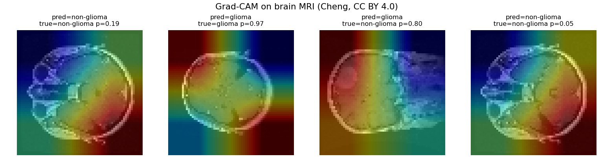
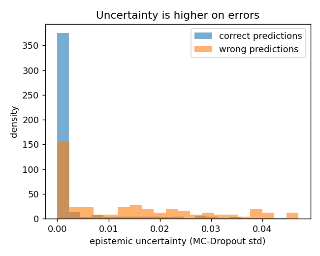

# Explainable, uncertainty-aware medical image classification

> Classifiers that do more than predict: they report **calibrated confidence**, **epistemic uncertainty** (MC-Dropout) and a **Grad-CAM** explanation. Two tracks with the same method: real brain MRI (Cheng brain tumour, glioma vs non-glioma, split by patient) and paediatric chest X-ray (PneumoniaMNIST). Runs on an entry-level GPU or on CPU.



## What it shows

A useful clinical classifier must also say *how sure* it is and *why*. This project combines three things often missing from demos:

1. **Uncertainty (MC-Dropout)**: T forward passes with dropout active at inference; the spread of the predictions estimates model uncertainty. Uncertainty is higher on **errors**, so it can act as a triage flag.
2. **Calibration (temperature scaling)**: raw network confidence is poorly calibrated; a single temperature fitted on the validation set reduces the **ECE**.
3. **Explainability (Grad-CAM)**: heatmaps of the regions that drive the prediction.

Every result is compared with a **baseline** (logistic regression on pixels) to measure what the deep model adds.

## Pipeline

```
data  ->  model (ResNet18 + dropout head)  ->  training
                         |
   +---------------------+----------------------+
uncertainty (MC-Dropout)  calibration (temperature)  Grad-CAM
   +---------------------+----------------------+
                         v
     metrics.json + figures (reliability, Grad-CAM, uncertainty)
              baseline: logistic regression
```

## Brain MRI track: glioma vs non-glioma (Cheng, CC BY 4.0)

Contrast-enhanced T1w slices from the **Cheng brain tumour dataset** (figshare, CC BY 4.0): 3064 slices from 233 patient IDs, grouped into 209 patients. Binary task: glioma vs meningioma/pituitary tumour.

**Split by patient**: train / validation / test = 148 / 20 / 41 patients (46 / 6 / 13 with glioma), stratified, seed 0. No patient appears in more than one split; patient IDs that differ only by a trailing letter (for example MR040240 and MR040240B, separate series of the same patient) are grouped together. Grouping is by ID only, so a patient listed under unrelated IDs would not be caught. Slices of the same patient are strongly correlated, so a slice-level split would let the model recognise patients it has already seen.

```bash
uv run python scripts/download_tumor.py    # all four figshare parts, ~880 MB, MD5-checked (data not committed)
uv run python scripts/evaluate_tumor.py    # ResNet18 + XAI + uncertainty -> results/tumor_*
```

Test set: 613 slices from 41 unseen patients (`results/tumor_metrics.json`).

| | AUROC | F1 | Accuracy |
|--|:--:|:--:|:--:|
| **ResNet18 (deep)** | **0.942** | 0.876 | 0.883 |
| Logistic baseline | 0.846 | 0.744 | 0.759 |

- **Calibration (ECE, lower is better)**: 0.076 -> **0.028** with temperature scaling (T = 2.50).
- **Uncertainty (MC-Dropout)**: 0.0048 on correct vs 0.0190 on wrong predictions, about 4.0x higher on errors.

**Reading the numbers.** The deep model is better than the baseline on every metric here, including accuracy and F1 at the fixed 0.5 threshold, and calibration reduces the ECE. Training runs a fixed 5 epochs without early stopping, with one seed and one split, so the threshold-dependent metrics are not stable from run to run. A single split with 13 glioma patients in the test set leaves wide uncertainty on every number. Report with references: [`report/brain_tumor_xai.md`](report/brain_tumor_xai.md).

## Chest X-ray track (PneumoniaMNIST, CC BY 4.0)

**PneumoniaMNIST** (MedMNIST v2): paediatric chest X-rays, *normal* / *pneumonia*, downloaded automatically through the `medmnist` package, resized to 64x64 and replicated to 3 channels. The official MedMNIST train/val/test split is used.

```bash
uv sync --extra dev
uv run pytest -q                                  # fast tests (no download)
uv run python scripts/download_data.py            # PneumoniaMNIST
uv run python scripts/train.py --epochs 3         # train (saves results/model.pt)
uv run python scripts/evaluate.py                 # metrics + figures
uv run streamlit run app/main.py                  # interactive app
```

624 test images, ResNet18 (ImageNet weights), 3 epochs:

| | AUROC | F1 | Accuracy |
|--|:--:|:--:|:--:|
| **ResNet18 (deep)** | **0.962** | 0.879 | 0.829 |
| Logistic baseline | 0.927 | 0.886 | 0.841 |

- **Calibration (ECE)**: 0.135 -> **0.121** (T = 1.39).
- **Uncertainty**: 0.0030 on correct vs 0.0134 on wrong predictions, about 4.5x higher on errors.



Same reading as for the brain track: better ranking (AUROC), but at the fixed 0.5 threshold accuracy and F1 are slightly below the linear baseline (threshold not tuned, imbalanced classes, 3 epochs). The point here is the uncertainty signal and the calibration, not squeezing accuracy.

## Limitations

- PneumoniaMNIST is low resolution: a reproducible benchmark, not a clinical model.
- Brain track: 2D slices, one split, short fixed training; the numbers carry wide uncertainty.
- MC-Dropout estimates *epistemic* uncertainty, not aleatoric noise in the data.
- Not for clinical use.

Architecture, data, metrics, intended use, ethics and limitations are in the [**model card**](MODEL_CARD.md).

## Data and licenses

- PneumoniaMNIST, MedMNIST v2 (Yang J. et al., *Scientific Data* 10:41, 2023, DOI: 10.1038/s41597-022-01721-8), CC BY 4.0. Downloaded at runtime, not included in this repository.
- Cheng J. et al., brain tumor dataset, figshare, DOI: 10.6084/m9.figshare.1512427, CC BY 4.0. Downloaded by script, not included.

## References

- Gal Y., Ghahramani Z., *Dropout as a Bayesian Approximation*, ICML 2016. arXiv:1506.02142
- Guo C. et al., *On Calibration of Modern Neural Networks*, ICML 2017. arXiv:1706.04599
- Selvaraju R.R. et al., *Grad-CAM*, ICCV 2017. DOI: 10.1109/ICCV.2017.74

## License

Code: MIT (see `LICENSE`).
