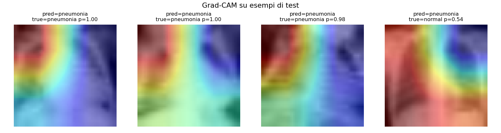

# 🫁 CXR · Classificazione spiegabile con incertezza

> Classificatore di radiografie del torace (**pneumonia vs normal**) che non si limita a predire: stima la **confidenza calibrata**, l'**incertezza epistemica** (MC-Dropout) e spiega la decisione con **Grad-CAM**. Su PneumoniaMNIST, eseguibile su GPU entry-level o CPU.



## Cosa dimostra

Un classificatore clinico utile deve dire anche *quanto è sicuro* e *perché*. Questo progetto mette insieme tre ingredienti spesso assenti nelle demo:

1. **Incertezza (MC-Dropout)** — T passaggi forward con dropout attivo a inferenza; la dispersione delle predizioni stima l'incertezza del modello. Sugli **errori** l'incertezza è più alta → utilità come flag di triage.
2. **Calibrazione (temperature scaling)** — la confidenza grezza delle reti è mal calibrata; una singola temperatura ottimizzata su validation riduce l'**ECE**.
3. **Spiegabilità (Grad-CAM)** — heatmap delle regioni che guidano la predizione.

Confronto con una **baseline** (regressione logistica sui pixel) per quantificare il valore aggiunto del modello profondo.

## Pipeline

```
data (PneumoniaMNIST)  →  model (ResNet18 + testa dropout)  →  training
                                   │
        ┌──────────────────────────┼───────────────────────────┐
   uncertainty (MC-Dropout)   calibration (temp. scaling)   gradcam
        └──────────────────────────┴───────────────────────────┘
                                   ▼
                metrics.json + figure (reliability, gradcam, incertezza)
                       baseline: regressione logistica
```

## Dataset

**PneumoniaMNIST** (MedMNIST v2): radiografie pediatriche del torace, classi *normal* / *pneumonia*. **Licenza CC BY 4.0**, **download automatico** senza registrazione (pacchetto `medmnist`). Immagini ridimensionate a 64×64 e replicate a 3 canali per il backbone.

> Yang J. et al., *MedMNIST v2 — A large-scale lightweight benchmark for 2D and 3D biomedical image classification*, Scientific Data 10:41, 2023. DOI: 10.1038/s41597-022-01721-8

## Come eseguire (uv)

```bash
uv sync --extra dev
uv run pytest -q                                  # test rapidi (no download)
uv run python scripts/download_data.py            # scarica PneumoniaMNIST
uv run python scripts/train.py --epochs 3         # addestra (salva results/model.pt)
uv run python scripts/evaluate.py                 # metriche + figure
uv run streamlit run app/main.py                  # app interattiva
```

## Risultati

Risultati su 624 immagini di test, ResNet18 (pesi ImageNet) addestrato 3 epoche.
Figure in `results/`; valori rigenerabili con `scripts/evaluate.py`.

| | AUROC ↑ | F1 ↑ | Accuracy ↑ |
|--|:--:|:--:|:--:|
| **ResNet18 (deep)** | **0.963** | 0.858 | 0.793 |
| Baseline logistica | 0.927 | 0.886 | 0.841 |

- **Calibrazione (ECE ↓)**: 0.172 → **0.146** con temperature scaling (T = 1.81).
- **Incertezza (MC-Dropout)**: media sugli errori **0.0104** vs sulle predizioni corrette **0.0033** → l'incertezza è **~3× più alta dove il modello sbaglia**, utile come flag di triage.


> **Lettura onesta dei numeri**: il modello profondo ha **AUROC nettamente superiore** (migliore *ranking*/discriminazione), ma alla soglia fissa 0.5 accuracy/F1 sono vicine — leggermente sotto — alla baseline lineare, perché la soglia non è ottimizzata e le classi sono sbilanciate. Con sole 3 epoche è atteso; il valore distintivo qui è il **segnale di incertezza** e la **calibrazione**, non lo squeezing dell'accuracy.

## Note metodologiche e limiti

- PneumoniaMNIST è a bassa risoluzione (immagini standardizzate): utile come benchmark riproducibile, non come modello clinico.
- MC-Dropout stima l'incertezza *epistemica*, non quella aleatoria del dato.
- Nessun uso clinico: scopo dimostrativo/educativo.

## Riferimenti

- Gal Y., Ghahramani Z., *Dropout as a Bayesian Approximation*, ICML 2016. arXiv:1506.02142
- Guo C. et al., *On Calibration of Modern Neural Networks*, ICML 2017. arXiv:1706.04599
- Selvaraju R.R. et al., *Grad-CAM*, ICCV 2017. DOI: 10.1109/ICCV.2017.74

## Licenza

Codice: MIT (vedi `LICENSE`). Dataset PneumoniaMNIST: CC BY 4.0.
